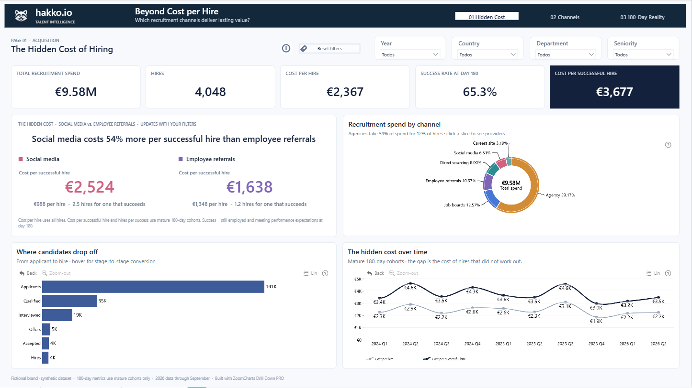
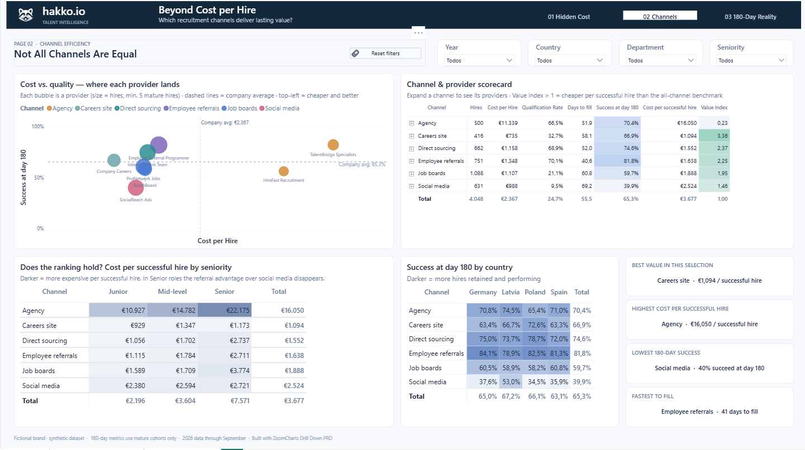
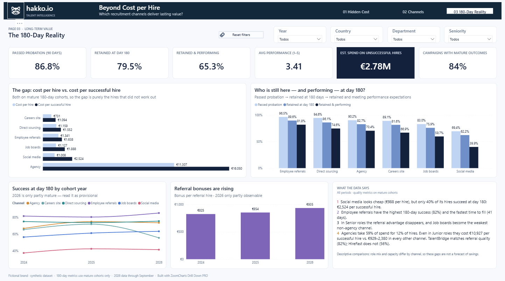
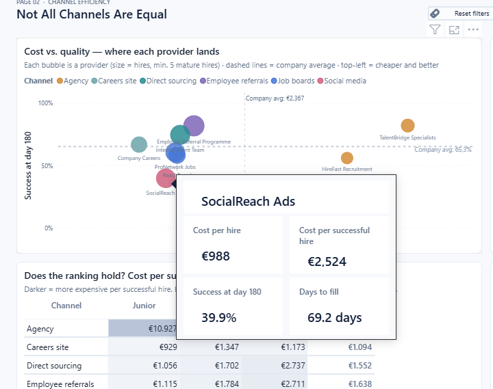

<p align="center">
  
</p>

<h1 align="center">Beyond Cost per Hire</h1>
<p align="center"><b>Which recruitment channels deliver lasting value?</b><br>
Power BI · ZoomCharts Drill Down PRO · DAX · People Analytics</p>

<p align="center">
  <a href="https://zoomcharts.com/en/microsoft-power-bi-custom-visuals/challenges/zoomcharts-power-bi-challenge-november-2026">ZoomCharts 4U Reports Challenge — November 2026 (Recruitment Analytics)</a>
</p>



## The question

Cost per hire is the metric most recruitment teams optimise. It is also misleading: a channel can be cheap per hire and expensive per hire that **actually works out**. This report follows €9.58M of recruitment spend and 4,048 hires across 6 channels and 8 providers, from first application to day 180, and asks which channels deliver hires that stay and perform.

## Key findings

| | Finding |
|---|---|
| **The hidden cost** | Social media looks cheap at **€988 per hire**, but only **40%** of its hires succeed at day 180, so it costs **€2,524 per successful hire**, 54% more than employee referrals (€1,638). It takes **2.5 hires to get one that succeeds**, vs. 1.2 for referrals. |
| **Agencies** | Agencies take **59% of spend for 12% of hires**. Seniority does not explain it: even in Junior roles they cost €10,927 per successful hire vs. €929–2,380 in every other channel. Within agencies, TalentBridge matches referral quality (82%); HireFast does not (56%). |
| **The ranking does not always hold** | The referral advantage disappears in Senior roles (€2,711 vs. €2,721 for social media), where job boards become the weakest non-agency channel. |
| **Unsuccessful hires** | An estimated **€2.78M** of mature-cohort spend went to hires that did not succeed by day 180 (proportional allocation). |

Recommendations in the report are descriptive: role mix and capacity differ by channel, so gaps are not presented as a savings forecast.

## The report

| Page | What it answers |
|---|---|
| **01 · The Hidden Cost of Hiring** | Where the money goes, where candidates drop off, and a dynamic headline comparing social media vs. referrals that rewrites itself for every filter combination. Three ZoomCharts Drill Down PRO visuals (Donut, Combo Bar, Combo). |
| **02 · Not All Channels Are Equal** | Cost vs. quality per provider with company-average quadrants, a channel → provider scorecard, heatmaps by seniority and country, and insight cards that update with the selection. |
| **03 · The 180-Day Reality** | Probation → retention → performance cascade, the gap between cost per hire and cost per successful hire, cohort trends, referral bonus inflation, and an executive summary with next steps. |




<p align="center"></p>

## Analytical decisions

- **Mature cohorts only.** 90- and 180-day outcomes are measured only on campaigns old enough to have them (`Mature90` / `Mature180`). Including recent cohorts would understate success rates. Cost per successful hire uses mature-cohort spend in both numerator and denominator.
- **Same-cohort comparison.** "Cost per hire vs. cost per successful hire" uses the same mature cohorts on both sides, so the gap is purely the hires that did not work out.
- **Weighted averages.** Time to fill and performance are hire-weighted (`TotalTimeToFillDays / Hires`, `PerformanceScoreTotal / PerformanceRatedHires`), not averages of averages.
- **Segment checks (Simpson's paradox).** Channel rankings are tested within seniority and country, which is how the Senior-role exception was found.
- **Minimum sample.** Scatter points and insight cards require at least 5 mature hires, so small segments do not produce misleading 0% / 100% results.
- **Like-for-like YoY.** 2026 data ends in September, so year-over-year comparisons use the same months.

## Interactivity

- Synced slicers (year, country, department, seniority) and a **Reset filters** button
- Drill-down from channel to provider in the ZoomCharts donut; cross-filtering across the page
- **Report-page tooltip** with a channel/provider scorecard on hover
- **"How to explore" panel** (bookmark-driven) with usage tips
- Text measures that render "—" or an explanatory message instead of blanks when a selection is empty

## Data model

Star schema: `FactRecruitment` (campaign × provider) with `DimDate`, `DimRole`, `DimChannel`, `DimLocation`, a disconnected `Funnel Stage` table, and a `_Measures` table with 90+ measures in display folders.

```
DimDate ─┐
DimRole ─┼──▶ FactRecruitment
DimChannel ┤      (1:* single direction)
DimLocation┘
Funnel Stage (disconnected) · _Measures
```

- [`dax/measures_core.dax`](dax/measures_core.dax): base, funnel, efficiency, quality, value, maturity and comparison measures
- [`dax/measures_ux.dax`](dax/measures_ux.dax): KPI text, dynamic headline, insight cards and tooltip measures

## Design system

Fictional brand **hakko.io · Talent Intelligence**. Navy `#14213D` header, `#F7F9FC` canvas, white cards. Channel colours are fixed across every page (Job boards `#4777D5`, Direct sourcing `#2B8D92`, Careers site `#6AA5A9`, Referrals `#7F65B8`, Agency `#D38C36`, Social media `#D0617F`). The theme is in [`theme/hakko_theme.json`](theme/hakko_theme.json).

## Repository contents

```
assets/   screenshots and logo
dax/      DAX measures
theme/    Power BI theme (JSON)
```

The `.pbix` is not included because it embeds a personal ZoomCharts developer license key. The dataset is the synthetic challenge dataset provided by ZoomCharts.

## Tools

Power BI Desktop · DAX · Power Query · ZoomCharts Drill Down PRO (Donut, Combo Bar, Combo) · Python (pandas) for validation against an independent audit of every measure

---

**Caio Bandeira** · Data Science & ML · [LinkedIn](https://www.linkedin.com/in/caio-bandeira-cv) · [Portfolio](https://caiobandeira7.github.io)
